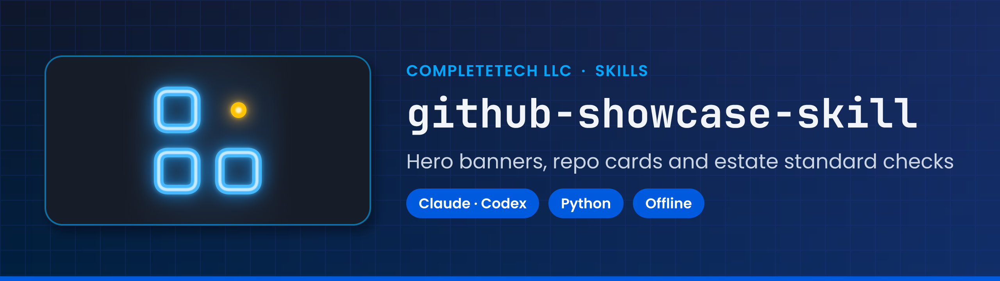
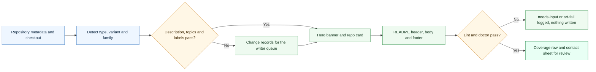
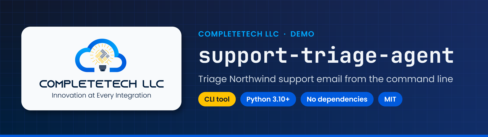
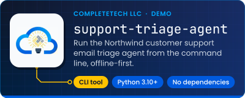

<!-- showcase:banner:start -->
<p align="center">
  
</p>
<!-- showcase:banner:end -->

<!-- showcase:nav:start -->
**CompleteTech LLC Skills** · [Start here](ONBOARDING.md) · [Agent instructions](SKILL.md) · [Skill library](https://github.com/CompleteTech-Skills/agentic-services-orchestrator-skill/blob/main/references/skill-family.md) · [Contributing](CONTRIBUTING.md)
<!-- showcase:nav:end -->

<div align="center">

# GitHub Showcase Skill

<!-- showcase:badges:start -->


[](https://github.com/CompleteTech-Skills/github-showcase-skill/actions/workflows/test-portability.yml)
<!-- showcase:badges:end -->

<!-- showcase:tagline:start -->
**Generate CompleteTech LLC README banners, repo cards and profile art, and check repositories against the standard.**
<!-- showcase:tagline:end -->

</div>

---

A CompleteTech LLC Claude and Codex skill that makes every repository in the CompleteTech GitHub estate look like part of one collection, and keeps it that way. It typesets the README hero banner, the repo card and the profile art from real metadata, and it checks descriptions, topics, labels and READMEs against the estate standard before anything is written.

## About

Part of the CompleteTech LLC skill library. This skill packages the CompleteTech GitHub estate standard (`ct-std-v1`) and its generators, so any agent can bring a repository, README, org profile or profile page to the standard with one CLI, and new repositories stay there through the composite Action that `completetech-repo-template` calls.

## OpenClaw / ClawHub Metadata

- Skill key: `github-showcase-skill`
- Homepage: https://github.com/CompleteTech-Skills/github-showcase-skill
- README: https://github.com/CompleteTech-Skills/github-showcase-skill#readme
- Runtime binaries: `python3`
- Python packages: `fonttools==4.67.0`, `uharfbuzz==0.57.0`, `pillow==13.0.0`, `pyyaml==6.0.3`
- Intended registry/discovery tags: `latest`, `completetech`, `claude-skill`, `codex-skill`, `agentic-ai`, `agent-skills`, `python`
- License: repository code, templates, and documentation use MIT; the repository is prepared for ClawHub publishing, not yet published (see `CLAW_HUB_PUBLISHING.md`).
- Brand assets: CompleteTech LLC names, logos, seals, and brand assets are reserved; see `BRAND_ASSETS.md`.

## Workflow Diagram

Source: [assets/diagrams/workflow.mmd](assets/diagrams/workflow.mmd).



## What It Does

- Generates the README hero banner in the golden php2shell-check layout: navy grid canvas, a card holding the repository's icon (or the org's Neon Night mark), a sky-blue company and category eyebrow, the slug in monospace, a one-line subtitle, two to four gold and blue fact chips, and a bottom accent bar.
- Generates the 1280×640 social preview and the 1600×400 org banner in the same design.
- Generates repo cards, org tiles and the animated profile intro as GitHub-safe SVGs, with every glyph outlined to paths and one dark design on both GitHub themes.
- Checks descriptions, topics, labels and READMEs against the closed rules of the standard, proposes the smallest passing change as diffs, `gh` commands and change records, and reports one definition-of-done row per repository.
- Renders org profile READMEs from the estate registry's public slice (leak-checked), and plans org About fields, pins and star lists, labels and `.github` health files, with an O-check row per org.
- Captures, lints and copies GitHub Projects boards from the estate template in two stages (structure only, nothing deleted), writes the board README, and plans the private cross-org Estate board.
- Snapshots the CompleteTech Enterprise read-only, checks it (E1–E14, the romgenie seat), and plans the approved profile and domain changes.
- Checks repository content: relative links and anchors, the language bar, Actions health and merge side effects, README images, the About sidebar, repository icons and the social preview.
- Keeps repositories current: README scaffolds that never drop a line and end with the CompleteTech LLC footer, plus a composite GitHub Action that regenerates the banner and card when the description, topics, type or icon change, and writes description and topic proposals to the run summary.

## Contents

- `SKILL.md` - agent instructions: when to use the skill, the workflow, every command, and the decisions that override the standard.
- `scripts/showcase.py` - the single CLI entry point for every generator, check and plan, including the `org`, `project`, `enterprise` and `content` command groups.
- `scripts/ctshowcase/` - the implementation package: typesetting, the SVG and PNG scene backends, generators, linters and checks.
- `action.yml` - the composite GitHub Action used by `completetech-repo-template` and by this repository's own Showcase workflow.
- `references/` - the standard in condensed form, the user decisions, `brand.yaml` (the single place for brand data) and the machine-readable rule files in `references/standard/`; `enterprise.yaml` and `references/enterprise/` hold the enterprise module's desired state and its read-only GraphQL queries.
- `assets/brand/`, `assets/orgs/`, `assets/fonts/` - brand masters, organization marks and the OFL fonts the generators place and outline.
- `examples/` - synthetic Northwind Trading Co. metadata, fixture checkouts, an example per-repository override file, a synthetic estate registry for the `org` commands (`examples/estate/`), and the script that regenerates every committed preview.
- `requirements.txt` - pinned Python dependencies for typesetting and compositing.

## Quick Start

```bash
python3 -m venv .venv && . .venv/bin/activate          # Ubuntu 24.04 and Homebrew Python refuse a system-wide pip install
python -m pip install -r requirements.txt
python3 scripts/showcase.py --meta examples/meta/northwind-support-triage-agent.json --repo-dir examples/repos/northwind-support-triage-agent banner --out output/banner.png
python3 scripts/showcase.py --meta examples/meta/northwind-support-triage-agent.json --repo-dir examples/repos/northwind-support-triage-agent card --out output/card.svg
cd ../your-repository && python3 ../github-showcase-skill/scripts/showcase.py --meta meta.json doctor --header
```

On a real repository, run the script from inside that repository's checkout (or pass `--repo-dir`): with `--meta`, a checkout whose `origin` is another repository is refused, and default outputs (`docs/images/...`) land in the target checkout, never in the skill. Outputs go only to the `--out` paths you choose; with `--write`, README marker blocks and `docs/images/` in the target checkout. Every GitHub change is printed as a proposal for a reviewed writer (or, used standalone, the user) to approve and apply.

## Commands

Every command runs through `python3 scripts/showcase.py`. All of them are read-only toward GitHub: GitHub changes leave as diffs, `gh` command lines, change records and `scripts/writer.py` jobs for a reviewed writer.

| Command | What it does |
|---|---|
| `banner`, `card`, `content social` | Hero banner PNG, repo card SVG and the 1280×640 social preview for one repository |
| `org-banner`, `org-tile`, `intro` | Org profile banner, org tile and the profile intro |
| `readme`, `footer` | README scaffold or upgrade (never drops a line) and the CompleteTech LLC footer |
| `describe`, `topics`, `labels` | Description keep-or-edit, topic merge and the label plan |
| `lint`, `doctor`, `contact-sheet` | SVG, README, banner, public-leak and prose lint; the definition-of-done row and the estate intake (`doctor --estate`); review sheets on both GitHub themes, including the G4 cross-surface sheet |
| `new`, `adopt` | Plan a new repository from the template, or bring an existing one into the standard (settings, topics, labels, security baseline), as writer jobs |
| `meta`, `fingerprint`, `fonts`, `config` | Metadata capture, render fingerprint, font check and brand config validation |
| `org profile`, `about`, `pins`, `labels`, `health`, `doctor` | Org profile README, About payload, pins and star list, labels, `.github` health files and the O-check row |
| `project capture-query`, `normalize`, `copy-plan`, `readme`, `lint`, `estate-plan` | GitHub Projects boards from the estate template |
| `enterprise snapshot-query`, `discover`, `snapshot`, `doctor`, `seat-check`, `diff`, `plan` | The CompleteTech Enterprise, read-only |
| `content social`, `icon`, `links`, `linguist`, `actions`, `images`, `sidebar` | Repository content checks and the social preview upload job |

`SKILL.md` documents every option; `references/org.md`, `references/projects.md`, `references/enterprise.md` and `references/content.md` cover the command groups.

## Example



<p align="center">
  
</p>

Example files: [Banner](assets/examples/banner-example.png) · [Card](assets/examples/card-example.svg) · [Org tile](assets/examples/org-tile-example.svg) · [Intro](assets/examples/intro-example.svg) · [README](assets/examples/readme-example.md) · [Footer](assets/examples/footer-example.md) · [Golden-layout render](assets/examples/banner-php2shell-golden.png) · [Social preview](assets/examples/social-preview-example.png) · [Org banner](assets/examples/org-banner-example.jpg) · Contact sheets: [banners](assets/examples/contact-sheet-banners.on-github-dark.png), [cards](assets/examples/contact-sheet-cards.on-github-dark.png), [profile](assets/examples/contact-sheet-profile.on-github-dark.png).

**Hero banner and repo card: Northwind Trading Co. support triage agent**

- Rendered from the synthetic metadata in `examples/meta/northwind-support-triage-agent.json`; no real repository data.
- The eyebrow, slug, subtitle and chips are typeset from the description, topics and manifests, never drawn by an image model.
- The same dark design serves the GitHub light and dark themes.
- The card lints clean against the GitHub-safe SVG rules and stays under its 40 KB budget.

```bash
python3 scripts/showcase.py --meta examples/meta/northwind-support-triage-agent.json --repo-dir examples/repos/northwind-support-triage-agent banner --out assets/examples/banner-example.png
python3 scripts/showcase.py --meta examples/meta/northwind-support-triage-agent.json --repo-dir examples/repos/northwind-support-triage-agent card --out assets/examples/card-example.svg --png assets/examples/card-example.png
bash examples/render_examples.sh   # every committed example, contact sheets and this README's own banner and card
```

## Inputs

| Input | Source | Used for |
|---|---|---|
| Repository metadata | `--meta FILE`, or `meta --from-gh OWNER/REPO` (read-only GETs) | description, topics, license, language, visibility, labels |
| Repository checkout | `--repo-dir DIR` | README, manifests, `assets/icon.png`, `.github/showcase.yml` |
| Per-repository overrides | `.github/showcase.yml` (content only: type, icon, subtitle, chips, category, variant; `for: OWNER/REPO` scopes them (any login of the org, the name in any case)) | banner and card text, README variant |
| Brand data | `references/brand.yaml` | palettes, fonts, logo paths, eyebrows, footer strings |

## Assets

| Asset | Path | Note |
|---|---|---|
| Brand masters | `assets/brand/` | Light logo, current dark logo and the candidate dark master (decision 19); placed unaltered. |
| Logo pair | `assets/logo.png`, `assets/logo-dark.png` | Byte-identical to the estate brand files. |
| Organization marks | `assets/orgs/` | Filled as the avatar system lands; used on the banner card until a repository has its own icon. |
| Fonts | `assets/fonts/` | Poppins, JetBrains Mono, Fraunces, Bricolage Grotesque and Press Start 2P under the SIL Open Font License, with sha256 in `FONTS.json`. |

## Brand Notes

Precise, factual and quiet: the art carries the brand, the words carry the facts. Every banner chip, subtitle and card line comes from the repository's own description, topics and manifests. Do not invent features, numbers, stars or claims, do not let an image model draw text or marks, and do not crop, recolour or redraw a logo.

## Runtime Permissions

This skill needs local filesystem access only for the documented showcase workflow. It reads the target repository checkout, a metadata JSON file, `references/` and `assets/` (and, for the org, project and content commands, the estate registry and approval files, read only and never copied), then writes only to the selected `--out`, `--png`, `--records`, `--jobs`, `--report` or `--out-dir` paths, or, with `--write`, the README marker blocks and `docs/images/`. It runs `scripts/showcase.py` and does not require credential access, persistence, privilege escalation, or destructive file operations. `meta --from-gh`, `labels --plan`, `adopt` and opt-in `org labels ORG --repos-from-gh` use the GitHub CLI for read-only GETs; no command performs a GitHub write (label plans leave as `gh` argv and writer jobs).

## Network Boundary

Generation and checks are local. The only network calls are read-only `gh api` GETs for `meta --from-gh`, `labels --plan`, `adopt` and opt-in `org labels ORG --repos-from-gh` (paginated discovery of the org repositories accessible to the authenticated account, including private repositories, their labels and file trees), read-only GraphQL queries for `enterprise discover` and `enterprise snapshot`, the opt-in link and image checks of `content links --online` and `content images --online`, the pinned font download of `fonts --fetch`, and the two read-only HEAD requests of `footer --check --online`, each only when asked. The skill does not include callbacks or any helper that posts run metadata to an external service. The composite Action pushes only into the repository it runs in.

## Source

The rules come from the CompleteTech GitHub estate standard `ct-std-v1` and the user decisions that override it (`references/decisions.md`). The banner layout is measured from the php2shell-check README banner; the card and intro build on the estate's outlined-SVG prototypes.

## License

Code, templates, and documentation are licensed under the MIT License. CompleteTech LLC names, logos, seals, and brand assets are reserved and are not licensed for reuse except to identify this project. See `LICENSE` and `BRAND_ASSETS.md`.

<!-- showcase:footer:start -->
<p align="center">
  <a href="https://www.complete.tech">
    <picture>
      <source media="(prefers-color-scheme: dark)" srcset="https://raw.githubusercontent.com/CompleteTech-Skills/github-showcase-skill/main/assets/brand/logo-dark.png">
      
    </picture>
  </a>
  <br>
  Built by <a href="https://www.complete.tech">CompleteTech LLC</a> · Innovation at Every Integration
</p>
<!-- showcase:footer:end -->
