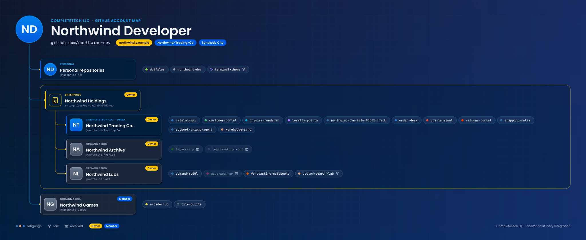

<!-- Generated by github-showcase-skill `showcase.py account-chart render` from the 2026-11-18 snapshot (ct-std-v1). Regenerate it; do not edit by hand. -->

  

21 public repositories across 1 enterprise and 4 organizations. Not shown: organizations with no public repositories shown, `.github` repositories and forks of repositories outside this account. Captured 2026-11-18. Mermaid source: <a href="account-chart-example.mmd">account-chart-example.mmd</a>.

Code across the repositories shown, excluding forks: Python 19.6%, TypeScript 14.8%, Jupyter Notebook 12.9%, C# 9.2%, Rust 6.9%, Swift 5.0%, Go 4.8%, PHP 4.4%, Vue 4.1%, JavaScript 3.6%, Kotlin 3.5%, C++ 3.3%, Svelte 2.9%, GDScript 2.6% and Shell 2.4%.

Every repository in this map

#### [Northwind Developer (@northwind-dev)](https://github.com/northwind-dev)

- [`dotfiles`](https://github.com/northwind-dev/dotfiles): Synthetic shell setup for the Northwind demo account.
- [`northwind-dev`](https://github.com/northwind-dev/northwind-dev): Synthetic profile README.

### [Northwind Holdings](https://github.com/enterprises/northwind-holdings) enterprise · owner

#### [Northwind Trading Co.](https://github.com/Northwind-Trading-Co) @Northwind-Trading-Co · owner

- [`catalog-api`](https://github.com/Northwind-Trading-Co/catalog-api): Synthetic product catalog API.
- [`customer-portal`](https://github.com/Northwind-Trading-Co/customer-portal): Synthetic customer self-service portal.
- [`invoice-renderer`](https://github.com/Northwind-Trading-Co/invoice-renderer): Synthetic invoice PDF renderer.
- [`loyalty-points`](https://github.com/Northwind-Trading-Co/loyalty-points): Synthetic loyalty points ledger.
- [`northwind-cve-2026-00001-check`](https://github.com/Northwind-Trading-Co/northwind-cve-2026-00001-check): Synthetic CVE check used by the estate fixtures.
- [`order-desk`](https://github.com/Northwind-Trading-Co/order-desk) 42 stars: Synthetic order desk for the support team.
- [`pos-terminal`](https://github.com/Northwind-Trading-Co/pos-terminal): Synthetic point-of-sale terminal app.
- [`returns-portal`](https://github.com/Northwind-Trading-Co/returns-portal): Synthetic returns and refunds portal.
- [`shipping-rates`](https://github.com/Northwind-Trading-Co/shipping-rates): Synthetic carrier rate shopping service.
- [`support-triage-agent`](https://github.com/Northwind-Trading-Co/support-triage-agent) 128 stars: Synthetic support triage agent for the Northwind demo.
- [`warehouse-sync`](https://github.com/Northwind-Trading-Co/warehouse-sync): Synthetic warehouse inventory sync.

#### [Northwind Archive](https://github.com/Northwind-Archive) @Northwind-Archive · owner

- [`legacy-erp`](https://github.com/Northwind-Archive/legacy-erp) archived: Synthetic retired ERP adapters.
- [`legacy-storefront`](https://github.com/Northwind-Archive/legacy-storefront) archived: Synthetic retired storefront.

#### [Northwind Labs](https://github.com/Northwind-Labs) @Northwind-Labs · owner

- [`demand-model`](https://github.com/Northwind-Labs/demand-model): Synthetic demand forecasting model.
- [`edge-scanner`](https://github.com/Northwind-Labs/edge-scanner) archived: Synthetic barcode scanner firmware.
- [`forecasting-notebooks`](https://github.com/Northwind-Labs/forecasting-notebooks) 17 stars: Synthetic forecasting notebooks.
- [`vector-search-lab`](https://github.com/Northwind-Labs/vector-search-lab) fork: Synthetic fork of a vector search library.

### Organizations

#### [Northwind Games](https://github.com/Northwind-Games) @Northwind-Games · member

- [`arcade-hub`](https://github.com/Northwind-Games/arcade-hub) 11 stars: Synthetic browser arcade.
- [`tile-puzzle`](https://github.com/Northwind-Games/tile-puzzle): Synthetic sliding-tile puzzle.

  

