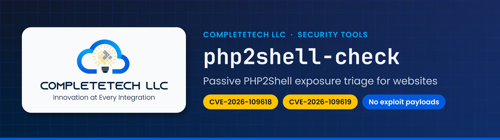

# Banner, card, tile and intro layout

Geometry for every generated surface. The README hero banner reproduces the golden reference, the php2shell-check README banner (1280×360), measured pixel by pixel. All four surfaces use one dark design on both GitHub themes (decision 21). Colours and fonts are not in this file: they come from the family in `references/brand.yaml`.

## README hero banner (`banner`)



The same repository as the skill derives it today, with the Security org's Neon Night mark until it has its own icon: [banner-php2shell.png](../assets/examples/banner-php2shell.png).

### Canvas and output

| Item | Rule |
|---|---|
| Logical size | 1280×360, full-bleed, opaque RGB, no rounded corners |
| Render scale | `--scale 2` by default: drawn at 2560×720 so it stays sharp at `width="100%"` on high-density screens |
| Save ladder (first that fits `--png-budget`, default 300,000 B) | 1. lossless PNG at 2× · 2. 256-colour quantized PNG at 2× (median cut, Floyd–Steinberg) · 3. 1280×360 Lanczos downsample, lossless · 4. the same, quantized · 5. otherwise exit 3, `art-fail:png-budget` |
| Accepted sizes | `lint banner` accepts exactly 1280×360 or 2560×720; the sidecar records the scale |
| Determinism | No PNG metadata chunks, compress level 9; the same inputs give byte-identical files |

### Geometry (1× units; multiply by the scale)

All y values are box tops measured from the golden. The text stack is centred on y = 180.

| Element | Spec | Golden measurement |
|---|---|---|
| Canvas | Family canvas. CompleteTech: vertical `ink → navy` gradient, a horizontal `#1E3A8A` lift from 0% at the left edge to 55% at the right (the golden's brighter right side, `canvas.overlay`), then a 32 px grid of the grid colour at 25% | left edge about `#0D1838`, right edge about `#193071` on the golden |
| Card shadow | Family `card_shadow` offset (CompleteTech: +6, +8), r = 24, black at 35%, Gaussian blur 12 (raster only) | soft shadow below and right of the card |
| Icon card | (56, 70)–(476, 290), 420×220, r = 24, family `card_fill`; or the icon's own ground (see the plate rule below) | bbox 56,70–476,290; fill 247,250,252 |
| Icon box | Inset 28 px: (84, 98)–(448, 262), 364×164. The icon is scaled to contain, centred, Lanczos; never upscaled beyond 2× its pixels (`needs-input:icon-resolution`). A square icon renders 164×164. A full-bleed icon fills the card height (220×220). | full logo centred in the card |
| Text column | x = 520, maximum width 704 (1280 − 520 − 56) | text starts at x = 520 |
| Eyebrow | `COMPANY` en space · en space `CATEGORY`, eyebrow font (Poppins SemiBold) 20 px, +6% tracking for upper-case families (+1% for lower- or mixed-case ones), eyebrow colour; cap-top 82; ladder 20 → 19 → 18; one line only | sky text rows 82–96, 409 px wide |
| Title | The repository **slug**, title font (JetBrains Mono Bold), title colour; cap-top 124 for one line; ladder 56 → 52 → 48 → 44 → 40 → 36; then two lines at 40 px wrapped at the last hyphen that fits (line height 1.1), the stack re-centred on y = 180; otherwise `art-fail` | ink rows 124–181 including descenders |
| Subtitle | Subtitle font (Poppins Regular) 26 px, subtitle colour (`#CBD5E1`, 11.2:1 on navy), cap-top 199; **one line**; ladder 26 → 24 → 22 | one line under the title |
| Chips | Top 243, height 38, fully rounded (r = 19), horizontal padding 16, gap 12, chip font (Poppins SemiBold) 18 px; 2–4 chips: 1–2 key (gold) first, then 0–3 attribute (blue) | gold chips span y 243–281 from x = 520 |
| Bottom bar | y 354–360, 6 px, family `bar` | 6 px rows 354–359 |

The golden's own colours (bar and attribute chips `#2563EB`, gold `#FACC15`, a diagonal canvas) are not reproduced: decision 13 says each family's palette replaces them, and the regression test compares layout masks, not colours.

### Eyebrow

`<COMPANY>` is the family `company_label` (CompleteTech: `COMPLETETECH LLC`). `<CATEGORY>` is the first that applies:

1. `--category`, or `category` in the repository's `.github/showcase.yml`;
2. `orgs.<Org>.banner_category` (for example `SECURITY TOOLS` for the Security org, the golden's eyebrow);
3. `orgs.<Org>.eyebrow` (the org identity table: `SKILLS`, `AI RESEARCH`, `SECURITY` and so on);
4. the card category of the detected type (`Agent skill`, `MCP server`, `CLI tool`, `Website`, `Game` and so on).

A type category is left out when it is the rule-25 `Workspace` fallback: the eyebrow is then the company label alone. `eyebrow_case: upper` uppercases the whole line (CompleteTech; all-caps is allowed only in compositor eyebrows). `asis` keeps the display case (T2 families show their display name as text). The card uses the same eyebrow function, so banner and card always agree.

### Subtitle

Every one-line candidate is tried first, in order, at 26 → 24 → 22 px: (1) `--subtitle`, (2) `subtitle` in `.github/showcase.yml`, (3) for a security check, the parenthesized short title in the description, (4) the description without its final period, (5) its first sentence, (6) heads of the first sentence: the text before `:`, `;` or ` — `, then before `, `, then before ` with ` / ` for `; a head needs three words and never ends on a dangling word (`built`, `made`, `using`, `based`, `powered`, `and`, `or`, `of`, `to`, `the`, `a`, `an`, ...). Only when none fits does the description wrap to two lines (24 → 22 px), logged `needs-input:subtitle`: give the repository a `subtitle:` that fits. Otherwise `art-fail:subtitle`. The subtitle is never truncated and never ends in an ellipsis.

### Chips (facts only, first rules first)

| # | Kind | Rule | Source |
|---|---|---|---|
| 1 | key | Every distinct `CVE-\d{4}-\d{4,}` in the slug, then the description, then the README header, in order; at most 2 | slug, description, README |
| 2 | key | Otherwise the card category of the detected type, unless it repeats an eyebrow word (`AI RESEARCH` / `Research`, `SKILLS` / `Agent skill`, `jevplay.games · Game` / `Game`) or is the `Workspace` fallback: then no gold chip, logged `needs-input:key-chip` | type table |
| 3 | attribute | Skills runtime: `Claude · Codex`, `Claude` or `Codex` from the `claude-skill` / `codex-skill` topics | topics |
| 4 | attribute | Language and floor version: `Python 3.10+` from `requires-python`, `Node 20+` from `engines.node`; else the bare top language | manifests, metadata |
| 5 | attribute | `No dependencies` when no manifest declares a runtime dependency and no lockfile exists; `Offline` only when the README matches `\boffline\b` and no HTTP client dependency exists | manifests, README |
| 6 | attribute | License SPDX for public repositories (`MIT`, `AGPL-3.0`); the Security pair shows `AGPL-3.0 or commercial`; private repositories show none | metadata, `LICENSING.md` |
| 7 | attribute | `chips.attrs` in `.github/showcase.yml` replaces rules 3–6; `chips.key` replaces rules 1–2 | override file |

Live-host chips are not used: a long host name pulls focus from the key chip. If the row is wider than 704 px, attribute chips drop from the end; key chips never drop. **Fewer than two chips is a hard stop** (exit 4, `needs-input:banner-chips`, nothing written): add `chips:` to `.github/showcase.yml` or pass `--key-chip`/`--chip`. `--allow-few-chips` (the Action uses it, so a new repository still opens with a banner) renders anyway with result `incomplete`; `lint banner` then reports `INCOMPLETE` and `doctor` reports `incomplete` and `done: no`. Every chip records its source in the sidecar.

### Icon on the card (decisions 12 and 13)

First match wins; the same file serves the banner card and the card's icon tile:

1. `icon` in `.github/showcase.yml` (repository-relative PNG);
2. `assets/icon.png`: 1024×1024 RGBA, transparent or with one opaque square ground, at most 300 KB, no text;
3. the org mark (`orgs.<Org>.mark`: the approved Neon Night avatar for every T1 org except CompleteTech-LLC), logging `needs-input:repo-icon`;
4. the family fallback, logging `needs-input:repo-icon`: for CompleteTech orgs the light CompleteTech logo (`brand_assets.logo_light`, the golden look), or in an icon box under 200 px (the card tile) its committed cloud-and-bulb crop `brand_assets.mark_light`, because the full wordmark would be about 3 px tall there; for every other family the family `company_label` typeset in its `display` font and `card_ink` colour on the family plate, over a short accent rule (one to three balanced lines, largest size that fits). A T2 card never shows the CompleteTech logo (decision 13; TouchedByAnAgent hold).

**Plate rule.** When the icon's four corner pixels are opaque and within ΔE 3 of each other, the icon brings its own ground: the card is filled with that colour and the icon is drawn full-bleed (inset 0, clipped to the card radius), with its ground feathered into the card where a square icon does not reach the card's sides. There is never a plate inside a plate. T2 families without an icon get a dark plate (`card_fill`: Jev `#0C075C`, LibreEvolve `#032530`, Touched By An Agent `#2F0132`, romgenie `#183B31`); AI Ascension keeps its paper `#EDE4D3`; jevplay.games uses pink `#F386A1`. Every plate darker than 20% luminance gets a 2 px edge in the family accent at 60%. jevplay.games icons (`icon_pixel_art`) are reduced to their native pixel grid and scaled nearest-neighbour at an integer factor (the §9.5 avatar rule), never filtered. A custom transparent icon (`--icon`, `showcase.yml` `icon`, `assets/icon.png`; PNG mode P with transparency or RGBA) is fitted by its alpha bounds in the icon box, so transparent margins do not shrink it; this is compositor behaviour only (the PNG file is unchanged), and bundled marks and logos, opaque or full-bleed icons, pixel-art icons and fully blank transparency keep their existing sizing.

### Refusals

| Case | Result |
|---|---|
| Excluded, hold or T3 owner | exit 2 |
| Watching-org fork | exit 0, `exempt` |
| `banner: keep-existing` (AI-Ascension) | the banner renders in the family palette and goes above the README's own banner (review q57 `aia` and `pres` defaults); exit 0, `exempt:keep-existing`, nothing written, only when `readme.preserve_banner` is `unchanged` and the README already opens with its own banner |
| Fewer than two chips | exit 4, `needs-input:banner-chips`, unless `--allow-few-chips` (result `incomplete`) |
| `hold: true` family (TouchedByAnAgent) | needs `--allow-hold` |
| `measured: false` family | needs `--allow-unmeasured`; otherwise exit 4, `needs-input:palette-v1.1` |
| Empty description | exit 4, `needs-input:description` |
| Type `fork`, `backup` or `github-profile` | the banner renders (G, H and J open with it; decisions 12, 13); `card` gives `exempt:no-card`. Exempt: watching-org forks (`exempt`), `CompleteDotTech/CompleteDotTech` (`exempt:profile-readme`) and a placeholder org's `.github` (`exempt:placeholder-org`) |

### Embed and alt text

One dark file, no `<picture>`:

```html
<p align="center">
  
</p>
```

`COMPANY` is `CompleteTech LLC` for T1 organizations, or the organization's display name for T2 (for example `jevplay.games`).

### Sidecar `docs/images/.showcase.json`

Written by `banner` and `card` when their output is under `docs/images/`. Sorted keys, no timestamps:

```json
{"schema": 1, "skill_version": "1.0.0", "standard": "ct-std-v1", "config_sha256": "…",
 "inputs": {"owner": "…", "repo": "…", "description": "…", "topics": ["…"], "visibility": "public",
            "license": "MIT", "language": "Python", "type": "cli", "icon_sha256": "…", "override_sha256": null},
 "fingerprint": "sha256 of the canonical inputs plus skill_version and config_sha256",
 "outputs": {"banner.png": {"sha256": "…", "px": [2560, 720], "bytes": 211234, "scale": 2, "repository_id": 123},
             "card.svg": {"sha256": "…", "bytes": 27110, "repository_id": 123}}}
```

`fingerprint` compares the current inputs with `fingerprint` here; the composite Action regenerates only when they differ. Each output record carries `repository_id`, the repository's immutable id from `meta --from-gh` (outside the fingerprint inputs), when the metadata has one.

Before it writes anything, the Action decides whether the art came from another repository (`action_prepare.py foreign`). Only proof counts: the sidecar is a template's (its `inputs.type` is `template`, or it names `CompleteTech-LLC/completetech-repo-template`), or its records carry a repository id other than `$GITHUB_REPOSITORY_ID`. Then a copied `assets/icon.png` (the sha256 the sidecar recorded) is removed (decision 12), and an output that cannot be regenerated yet is dropped. A sidecar that only names another slug is the repository's own art after a rename, a transfer or an org rename: nothing is removed, a notice says so, and the changed fingerprint regenerates the art under the new name. A template repository is never foreign to itself.

## Repo card (`card`)

| Item | Rule |
|---|---|
| Canvas | `viewBox="0 0 400 160"`, `width="400" height="160"`, rounded plate (r = 12) on the family canvas with a 20 px grid; edge hairline in the eyebrow colour at 28% |
| Accessibility | `role="img"`; `aria-label` and `<title>` both equal `REPO: DESCRIPTION` |
| Icon tile | 88 px tile at (16, 22), r = 16, holding the banner's icon under the same plate rule; shadow is the family `card_shadow` at half its offset and blur (jevplay: a hard 3 px pink offset); a gold trace runs from the tile to a solder pad beside the first chip |
| Eyebrow | The banner's eyebrow (one shared function: `COMPLETETECH LLC · SECURITY TOOLS`, `jevplay.games · Game`), 10.5 → 10 → 9.5 px with the banner's tracking; the company label alone when the category cannot fit. Baseline fixed at y = 26 on every card |
| Name | The slug; ladder 21 → 19 → 17 → 16 → 15 → 14 on one line (a 30-character slug fits at 14 px), then two lines at 17 → 14 px split at the hyphen that gives the most even lines, never inside a `cve-YYYY-NNNN` id |
| Description | The GitHub description verbatim; three lines at 12.5 → 12 → 11.5 → 11, then four lines at 11.5 → 11, while the block ends 5 px above the chips; the eyebrow never moves; never truncated, otherwise `art-fail:card-description` |
| Chips | 10.5 px text, 20 px tall at y = H − 36; the banner's chip order: key chips (both CVE ids when they fit), then the attributes, where a bare language is drawn as the language dot in its place, then stars |
| Drop order | stars, then attribute chips from the end, then the second key folds into `CVE-… +1`; the first key chip never drops |
| Language dot | GitHub linguist colour from the `languages` table in `brand.yaml` |
| Stars | Shown only at 10 or more |
| Bottom bar | 4 px, the family `bar` (the banner's recipe) |
| Budget | ≤ 40 KB hard, ≤ 30 KB target; the icon is embedded as WebP q84 at 2× (≤ 136 px) |
| Gate | `lint svg --kind card` must PASS before the file is written; otherwise exit 1 and nothing is written |

## Org tile (`org-tile`)

| Item | Rule |
|---|---|
| Canvas | `viewBox="0 0 400 160"`, the family canvas |
| Left | An 88 px tile holding the org avatar (`<Org>/.github/profile/assets/avatar-500.png`, passed by path). A Neon Night avatar brings its own night tile, so it is drawn full-bleed (r = 16) with the family accent edge, never inside a second plate; any other avatar sits at 72 px on the navy tile |
| Text | The org display name (Poppins SemiBold, 21 → 16), the family eyebrow, and the first sentence of the org description verbatim (at most 2 lines, 12 → 11.5) |
| Right (optional) | `--illustration` keyed PNG or WebP in the box (256, 16)–(384, 144); the text column narrows to 136 px |
| Numbers | None; counts change and belong in Markdown |

## Profile intro (`intro`)

| Item | Rule |
|---|---|
| Canvas | `viewBox="0 0 1280 320"` by default (`--height 360` is the option the user may choose), navy grid plate, rx 16 |
| Defaults, personal profile | Name `Timothy Wayne Gregg`; eyebrow `COMPLETETECH LLC · CINCINNATI, OHIO`; tagline `Innovation at Every Integration`; chips `key:complete.tech`, `attr:Founder`, `attr:AI integration` |
| Defaults, org | The org display name; eyebrow `COMPLETETECH LLC · ORG EYEBROW` |
| Mark | The selected dark master, or `mark-dark.png` when committed, directly on navy with a radial-gradient glow; never cropped |
| Text column | x = 484: eyebrow, name (Poppins SemiBold 62 px), typed tagline in JetBrains Mono 32 px with a sky block caret that blinks 3 times then stays solid, then the chips |
| Traces | The two gold traces leave from pads 8 px right of the cloud (`x = mark x + 0.7004 × mark width + 8` on the full logo), at 20% and 45% of the mark's height, inside the cloud band above the wordmark; they turn at `x = mark right + 24` (440), so the diagonal passes about 24 px above the eyebrow and nothing touches "LLC" |
| Motion | Only the personal profile and T1 flagship orgs (`flagship: true`) animate; others are forced `--static`. Gold circuit traces draw in from the pads (0.2–1.4 s), the tagline types (0.6–2.2 s), then three signals ride the traces on 6.1, 7.7 and 9.3 s loops |
| Resting state | The revealed frame is the default state: traces drawn, tagline and caret at the end. Animations run from the hidden state with `animation-fill-mode: backwards`, so renderers without CSS animation (resvg, image proxies) show the finished intro, not a blank tagline. `contact-sheet` renders the intro's static frame through the optional `resvg_py` |
| Reduced motion | A `.still` group draws the settled frame and replaces the `.anim` group under `prefers-reduced-motion: reduce` |
| Output | Exactly one file; there is no `-dark` sibling |
| Budget | ≤ 300 KB hard, ≤ 120 KB target; `lint svg --kind intro` must PASS |

## Family skins

The plate and positions are identical in every family; only the canvas texture, motif, display font and colour tokens change.

| Family | Canvas | Notes |
|---|---|---|
| CompleteTech | Vertical gradient, the golden's horizontal lift, a 32 px grid (20 px on cards) | Golden reference family |
| AI Ascension | Flat ink | Keeps a README's own banner (`banner: keep-existing`); a README without one gets this skin; Fraunces titles; paper card |
| Jev Engineering | Flat near-black with a 32 px cyan grid at 7% | Palette `measured: false` until re-measured |
| jevplay.games | Dark ink `#1E1E1E` with a magenta halftone layer (decision 21's dark design; the pink-ground variant is not used); pink card | Pink key chip, plum attribute chips with pink text (6.35:1); Press Start 2P only at 36 px or larger |
| LibreEvolve | Flat dark navy with a 32 px emerald grid at 7% | Palette `measured: false` until re-measured |
| Touched By An Agent | Flat maroon with a 32 px amber grid at 7% | `hold: true` until the user decides whether it mentions CompleteTech |
| romgenie | Flat dark teal with a 32 px gold grid at 7% | Own work only; watching-org forks get no art |

When a chip text colour is not set, the generator picks the candidate with the highest WCAG contrast among the family title colour, `#0F172A`, `#FFFFFF` and `#1E1E1E`. Every text and background pair must reach 4.5:1, or the render fails.

## Social preview (`content social`) and org banner (`org-banner`)

| Surface | Rule |
|---|---|
| Social preview | 1280×640 (STANDARD §9.5, R10), the family canvas and bar. Eyebrow at (64, 84); the README H1 (else the title-cased slug) in the display font at 60 → 48 px, at most two lines in 600 px; a 120×4 accent rule ending in a gold solder pad; the type category in the accent colour; the description verbatim, at most three lines (24 → 20 px); `github.com/OWNER/REPO` in JetBrains Mono. The icon card (496×344 at x = 720) follows the plate rule. PNG within 900 KB, else JPG q85. Upload it in the repository settings (UI only). |
| Org banner | 1600×400 JPG q85 within 400 KB. CompleteTech: the selected dark master at 480×240 from x = 96; other families: the display name in the display font; `--illustration` in the box (1040, 40)–(1504, 360). |
